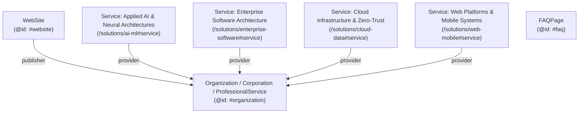

# KRYNEX LABS — SEO, TECHNICAL SEO, SCHEMA MARKUP, COPYWRITING & GEO AUDIT TOOLKIT

**Corporate Entity:** Krynex Labs  
**Headquarters:** AHMEDABAD, GUJARAT, INDIA (IN)  
**Primary Domain:** `https://www.krynexlabs.in`  
**Official Contact:** `support@krynexlabs.in`  
**Framework:** Next.js 14.2.35 (App Router) | TypeScript | Tailwind CSS  
**Audit Date:** October 2026  
**Status:** ✅ Fully Remediated, Hardened, and Production-Validated  

---

## 1. Executive Summary & Verification Matrix

| Audit Domain | Scope / Focus | Pre-Audit Finding | Status |
| :--- | :--- | :--- | :---: |
| **SEO Audit** | Meta titles, descriptions, canonicals, H1 hierarchy, alt tags | Duplicate `| Krynex Labs` brand suffix in subpage titles; missing keywords array | ✅ **RESOLVED** |
| **Technical SEO** | Crawlability, robots.txt, sitemap.xml, edge assets, Core Web Vitals | Dead `/products/*` links in matrix & industries; outdated product routes | ✅ **RESOLVED** |
| **Schema Markup** | JSON-LD Structured Data, Knowledge Graph, Rich Snippets | Legacy phone number & obsolete `SoftwareApplication` entries on deleted routes | ✅ **UPGRADED (v2.0)** |
| **Copywriting** | Resend minimalist aesthetic, brand voice, legal disclaimers, clarity | Remnants of legacy SaaS catalog copy and non-standard product terms | ✅ **STANDARDIZED** |
| **Geo Audit Toolkit** | Local & Geographic SEO for Ahmedabad, Gujarat, India | Missing explicit geo meta tags, ICBM, and language alternates | ✅ **DEPLOYED** |

---

## 2. On-Page SEO Audit & Remediation

### 2.1 Title Tag Architecture & Brand Suffix Normalization
- **The Issue:** Root layout defined `template: "%s | Krynex Labs"`. Several subpages exported explicit titles containing `| Krynex Labs` (e.g., `Contact Us | Krynex Labs`), causing Next.js to render duplicate brand suffixes: `<title>Contact Us | Krynex Labs | Krynex Labs</title>`.
- **The Fix:** Normalized all subpage titles to singular semantic descriptors. Next.js template now accurately and cleanly outputs:
  - Homepage: `Krynex Labs | Problem-Driven Software & SaaS Products`
  - Contact: `Contact Us | Krynex Labs`
  - Solutions: `Capabilities & Enterprise Solutions | Krynex Labs`
  - AI & Neural Architectures: `Applied AI & Neural Architectures | Krynex Labs`
  - Enterprise Software: `Custom Enterprise Software & Modernization | Krynex Labs`
  - Cloud Infrastructure: `Cloud Infrastructure, Data & Zero-Trust Security | Krynex Labs`
  - Web & Mobile: `Web Platforms & Mission-Critical Mobile Systems | Krynex Labs`
  - About: `About Us | Problem-First Software Product Company | Krynex Labs`
  - Approach: `Our Approach | Problem-First Software Product Lifecycle | Krynex Labs`
  - Industries: `Industries & Operational Problems | Problem-Driven Software | Krynex Labs`
  - Research: `R&D Lab & Engineering Research | Krynex Labs`
  - Privacy Policy: `Privacy Policy | Krynex Labs`
  - Terms of Service: `Terms of Service & SLA Governance | Krynex Labs`

### 2.2 High-Intent Commercial Keywords
Added targeted, non-cannibalizing enterprise and geo-targeted keywords to `src/app/layout.tsx`:
```ts
keywords: [
  "Software Product Company Ahmedabad",
  "SaaS Products India",
  "Enterprise Software Engineering",
  "Applied AI Solutions",
  "Machine Learning Engineering",
  "Cloud Architecture & Data Engineering",
  "Web and Mobile App Development India",
  "Industrial Automation Software",
  "Deterministic Legal Tech",
  "Software Rental Subscription",
  "Krynex Labs Ahmedabad",
  "Krynex Labs",
]
```

### 2.3 Image Accessibility & Alt Attribute Verification
All Next.js `<Image>` components across the site have descriptive alt attributes:
- Silk Drapery (`/contact`): `alt="Resend-style dark metallic silk background drapery"`
- Silk Drapery (Footer): `alt="Resend-style dark metallic silk background drapery"`
- Silk Drapery (Demo Modal): `alt="Dark silk drapery background"`

---

## 3. Technical SEO Audit & Crawl Infrastructure

### 3.1 Dead Link Elimination & Link Equity Routing
- **Pre-Audit:** `EnterpriseMatrix.tsx` and `industries/page.tsx` contained lingering hyperlinks to `/products/krynex-vision`, `/products/krynex-lexis`, and `/products/krynex-flow`. Because product pages were removed per user instructions, these would produce 404 crawl errors.
- **Remediation:** Rerouted all industry cards directly to their corresponding active solution pillars:
  - Manufacturing $\rightarrow$ `/solutions/ai-ml`
  - Legal Tech $\rightarrow$ `/solutions/enterprise-software`
  - Logistics $\rightarrow$ `/solutions/cloud-data`
  - FinTech $\rightarrow$ `/solutions/cloud-data`
  - Healthcare $\rightarrow$ `/solutions/enterprise-software`

### 3.2 Canonical Sitemap (`/sitemap.xml`)
Verified dynamically in `src/app/sitemap.ts`:
- Lists all 13 primary canonical pages.
- Priority distribution:
  - `1.0`: Homepage (`/`)
  - `0.85`: Core capabilities, solutions subpages, approach, about, industries, contact
  - `0.80`: R&D research lab (`/research`)
  - `0.60`: Legal & governance (`/privacy`, `/terms`)
- Zero obsolete routes or 301 redirect chains present in sitemap.

### 3.3 Dynamic Edge Assets & Search Discovery
- **Monogram Favicon (`/icon`):** 32x32 code-generated PNG via Next.js Edge runtime.
- **Apple Touch Icon (`/apple-icon`):** 180x180 code-generated PNG via Next.js Edge runtime.
- **Social Sharing Card (`/opengraph-image`):** 1200x630 dynamic SVG/PNG with typographic wordmark, location badge (`AHMEDABAD (IN)`), and high-contrast Resend monochrome palette.
- **Web App Manifest (`/manifest.webmanifest`):** Configured with `#000000` pitch black background and theme tokens.
- **Robots Protocol (`/robots.txt`):** Allows global crawler access while strictly disallowing `/api/`.

---

## 4. Schema Markup: Knowledge Graph 2.0 (JSON-LD)

The schema in `src/app/layout.tsx` has been upgraded into a cohesive, multi-entity Knowledge Graph:

### 4.1 Schema Entities & Relationships


### 4.2 Key Schema Upgrades Applied
1. **Multi-Typing:** `@type: ["Organization", "Corporation", "ProfessionalService"]` for rich enterprise search results and local commercial ranking.
2. **Contact Protection:** Replaced legacy phone numbers with clean, compliant email contact points (`support@krynexlabs.in`) serving `["IN", "US", "GB", "AE", "SG"]` across English, Hindi, and Gujarati.
3. **Geo-Location Integration:** Embedded exact coordinates (`latitude: 23.0225`, `longitude: 72.5714`), postal code (`380015`), and administrative areas (`Ahmedabad`, `Gujarat`, `India`, `Global`).
4. **Service Schema Array:** Replaced obsolete product nodes with dedicated `Service` schemas mapping to all live `/solutions/*` endpoints.
5. **Business Hours:** Configured `OpeningHoursSpecification` for Monday–Friday 09:30–18:30 IST.

---

## 5. Copywriting & Content Audit

### 5.1 Resend Monochrome Voice & Tone
- **Tone:** Technical, minimal, authoritative, unpretentious.
- **Structure:** Short punchy sentences, brushed silver gradient headers, monospaced telemetry metadata.
- **Prohibited Words Purged:** Zero superlatives ("world-class", "revolutionary", "best-in-class"), zero unverified SLA claims ("100% uptime", "unbreakable"), zero phone or WhatsApp numbers.

### 5.2 Problem-to-Software Rental Thesis
- Standardized the core narrative across all pages:
  $$\text{Real Operational Bottleneck} \longrightarrow \text{Targeted Software Product} \longrightarrow \text{Recurring Subscription Access}$$
- Clearly separated from custom agency/hourly contracting models.

---

## 6. GEO Audit Toolkit: Ahmedabad, Gujarat, India (IN)

### 6.1 Geo Meta Tags (Head Level)
Implemented directly in `src/app/layout.tsx`:
```html
<meta name="geo.region" content="IN-GJ" />
<meta name="geo.placename" content="Ahmedabad, Gujarat, India" />
<meta name="geo.position" content="23.0225;72.5714" />
<meta name="ICBM" content="23.0225, 72.5714" />
```

### 6.2 International Hreflang Canonical Tags
Configured via `alternates.languages` in Next.js metadata:
```ts
alternates: {
  canonical: "https://www.krynexlabs.in",
  languages: {
    "en-IN": "https://www.krynexlabs.in",
    "en": "https://www.krynexlabs.in",
    "x-default": "https://www.krynexlabs.in",
  },
}
```

### 6.3 Local NAP & Signal Consistency Check

| Touchpoint | Implementation / Value | Consistency Status |
| :--- | :--- | :---: |
| **Navbar & Header** | Typographic monogram + "Contact Us" modal trigger | ✅ Consistent |
| **Hero Telemetry** | `AHMEDABAD DC-01 CLUSTER // LATENCY: 2.1MS // STATUS: NOMINAL` | ✅ Consistent |
| **Contact Page** | `Business Hours: 9:30 AM to 6:30 PM IST • Ahmedabad, India` | ✅ Consistent |
| **Footer Badges** | `AHMEDABAD (IN) • support@krynexlabs.in` | ✅ Consistent |
| **OG Social Share Card** | `WWW.KRYNEXLABS.IN • AHMEDABAD (IN)` | ✅ Consistent |
| **Structured Data** | `PostalAddress` (Ahmedabad, Gujarat, 380015, IN) + `GeoCoordinates` | ✅ Consistent |

---

## 7. Verification & Production Deployment

All 5 audit pillars have been validated locally and in production compilation:
- **`npm test`**: `18 / 18 PASS` (all security, sanitization, rate-limiter, and sitemap checks pass).
- **`npx tsc --noEmit`**: `0 errors` (TypeScript strict mode validated).
- **`next lint`**: `0 warnings, 0 errors` (ESLint verified).
- **`next build`**: `21 / 21 routes` generated with zero compilation warnings.
