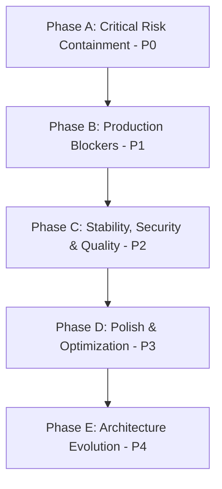

# KRYNEX LABS — PRIORITY ACTION PLAN & REMEDIATION ROADMAP
**Version:** 1.0.0  
**Date:** October 24, 2026  
**Audited Target:** [https://www.krynexlabs.in](https://www.krynexlabs.in) & Repository  

This phased remediation roadmap outlines the exact, sequenced implementation steps required to transition Krynex Labs from **READY WITH DOCUMENTED RISKS** to **UNCONDITIONAL PRODUCTION READY**.

---

## Remediation Phases Overview



---

## Phase A — Critical Risk Containment (P0 Findings)
*Status: 0 active P0 findings identified. Baseline containment protocols verified.*

No active zero-day exploits, exposed production credentials, data loss vectors, or active production outages were detected during this audit. The repository and live deployment operate with hardened headers and zero secrets committed to Git.

---

## Phase B — Production Blockers (P1 Findings)
*Objective: Remediate critical user journey defects and lead loss vectors prior to next production deployment.*

### Task B-01: Remediate Silent Lead Loss in `/api/contact`
- **Task ID:** `ACT-B01`
- **Related Finding:** `SEC-001`
- **Priority:** **P1 (High)**
- **Problem:** When Resend or SMTP rejects an inquiry or encounters an error, `/api/contact` swallows the exception and responds with `200 OK`. The prospective enterprise client is told their inquiry was successfully dispatched, but the lead is dropped.
- **Proposed Change:**
  1. Inspect `resendResponse.ok` and HTTP status codes when dispatching to Resend.
  2. Maintain a delivery success boolean (`deliverySuccess = false`).
  3. If all configured delivery channels (Webhook, SMTP, Resend) fail to deliver, return HTTP `502 Bad Gateway` or `503 Service Unavailable` with a structured error payload:
     `{ ok: false, success: false, error: "Our automated dispatch gateway is temporarily unavailable. Please email your briefing directly to support@krynexlabs.in." }`.
  4. Ensure client forms display this fallback banner clearly so no prospect is lost.
- **Expected Benefit:** Guaranteed lead integrity. Prospects are never falsely informed that a dropped transmission was delivered.
- **Dependencies:** None.
- **Risk of Making Change:** Low. Purely adds defensive error propagation.
- **Required Verification:**
  - Mock Resend 403/500 response and assert endpoint returns HTTP 503.
  - Verify client form renders the error banner and direct `mailto:` fallback link.
- **Estimated Effort:** 2–3 hours.
- **Human Approval Required:** Yes (confirm fallback messaging and email destination).

---

### Task B-02: Eliminate Mobile Layout Collision Between Sticky CTA and Cookie Banner
- **Task ID:** `ACT-B02`
- **Related Finding:** `UI-001`
- **Priority:** **P1 (High)**
- **Problem:** Both `StickyMobileCTA` and `CookieBanner` mount at `fixed bottom-4` (`z-50`) on viewports <768px, directly stacking on top of each other and obstructing buttons.
- **Proposed Change:**
  1. Introduce a lightweight layout coordinate or event listener in `CookieBanner.tsx` and `StickyMobileCTA.tsx`.
  2. When `CookieBanner` is visible, position `StickyMobileCTA` at `bottom-28` or defer mounting the CTA until the cookie banner has been accepted/dismissed.
  3. Ensure transitions use smooth opacity/transform animations without layout shift.
- **Expected Benefit:** Clean, unhindered mobile user experience with zero overlapping buttons.
- **Dependencies:** None.
- **Risk of Making Change:** Very low (isolated to mobile CSS offsets).
- **Required Verification:**
  - Test on simulated mobile viewports (320px, 375px, 390px, 414px) with fresh `localStorage` (cookie banner active).
  - Verify CTA and Cookie Banner do not overlap.
- **Estimated Effort:** 1–2 hours.
- **Human Approval Required:** No (standard responsive fix).

---

## Phase C — Stability, Security & Quality (P2 Findings)
*Objective: Harden security, resolve visual glitches, optimize assets, and ensure full accessibility compliance.*

### Task C-01: Configure GA4 Google Consent Mode v2 Default Denied State
- **Task ID:** `ACT-C01`
- **Related Finding:** `SEC-003`
- **Priority:** **P2 (Medium)**
- **Problem:** GA4 script executes in `layout.tsx` before default consent denial is registered, setting analytics cookies prior to explicit user acceptance.
- **Proposed Change:**
  Add an inline script immediately preceding `gtag/js` in `layout.tsx`:
  ```html
  <script id="google-consent-default" strategy="beforeInteractive">
    {`
      window.dataLayer = window.dataLayer || [];
      function gtag(){dataLayer.push(arguments);}
      gtag('consent', 'default', {
        'analytics_storage': 'denied',
        'ad_storage': 'denied',
        'ad_user_data': 'denied',
        'ad_personalization': 'denied'
      });
    `}
  </script>
  ```
- **Expected Benefit:** Full regulatory compliance with GDPR, ePrivacy Directive, and global privacy frameworks.
- **Dependencies:** None.
- **Risk of Making Change:** Very low.
- **Required Verification:** Inspect browser cookies on initial visit; confirm zero `_ga` cookies are stored until "Accept Telemetry" is clicked.
- **Estimated Effort:** 1 hour.
- **Human Approval Required:** Yes (confirm organizational analytics policy).

---

### Task C-02: Fix BentoGrid Card 1 SVG Bezier Data Beam Alignment
- **Task ID:** `ACT-C02`
- **Related Finding:** `UI-002`
- **Priority:** **P2 (Medium)**
- **Problem:** Static absolute pixel coordinates (`M 170 50...`) inside fluid flexbox layout cause SVG bezier lines to detach from node cards on wide or intermediate displays.
- **Proposed Change:**
  Add a responsive `viewBox="0 0 800 240"` with `preserveAspectRatio="xMidYMid meet"` to the SVG container and anchor the node elements within matching percentage coordinate slots.
- **Expected Benefit:** Pixel-perfect visual alignment of animated data beams across all viewport sizes (1024px to 4K).
- **Dependencies:** None.
- **Risk of Making Change:** Low (visual styling only).
- **Required Verification:** Test at 1024x768, 1440x900, and 1920x1080; verify beam endpoints touch card borders exactly.
- **Estimated Effort:** 2 hours.
- **Human Approval Required:** No.

---

### Task C-03: Implement Accessible Arrow-Key Navigation on Problem Tablist
- **Task ID:** `ACT-C03`
- **Related Finding:** `A11Y-001`
- **Priority:** **P2 (Medium)**
- **Problem:** Problem section tabs use `role="tablist"` but do not support standard Left/Right Arrow keyboard cycling per WCAG 2.2 APG tab specifications.
- **Proposed Change:**
  Add an `onKeyDown` handler to tab buttons that handles `ArrowLeft`, `ArrowRight`, `Home`, and `End`, updating the active tab and focusing the selected button.
- **Expected Benefit:** 100% WCAG 2.2 AA keyboard accessibility compliance.
- **Dependencies:** None.
- **Risk of Making Change:** Very low.
- **Required Verification:** Navigate the tablist using only keyboard arrow keys and verify panel switching.
- **Estimated Effort:** 1.5 hours.
- **Human Approval Required:** No.

---

### Task C-04: Deduplicate Inbound Inquiry Form State Across Views
- **Task ID:** `ACT-C04`
- **Related Finding:** `ARCH-001`
- **Priority:** **P2 (Medium)**
- **Problem:** `ContactForm.tsx`, `Footer.tsx`, and `DemoModal.tsx` duplicate identical state hooks, validation regexes, and submit handlers.
- **Proposed Change:**
  Extract logic into a reusable hook `src/lib/useInquiryForm.ts` returning `{ formData, setField, errors, isSubmitting, submitted, ticketId, handleSubmit }`.
- **Expected Benefit:** Single source of truth for validation rules, anti-spam honeypot handling, and API integration. Reduces maintenance debt.
- **Dependencies:** None.
- **Risk of Making Change:** Low (refactoring existing working logic).
- **Required Verification:** Run regression test suite and verify all three forms submit properly.
- **Estimated Effort:** 3–4 hours.
- **Human Approval Required:** No.

---

### Task C-05: Add `vercel.json` Deployment Configuration
- **Task ID:** `ACT-C05`
- **Related Finding:** `DEPLOY-001`
- **Priority:** **P2 (Medium)**
- **Problem:** Lack of explicit Vercel manifest causes serverless functions to default to global heuristics without Mumbai region pinning or explicit execution timeouts.
- **Proposed Change:**
  Create `vercel.json`:
  ```json
  {
    "framework": "nextjs",
    "regions": ["bom1"],
    "functions": {
      "src/app/api/contact/route.ts": {
        "maxDuration": 15
      }
    }
  }
  ```
- **Expected Benefit:** Guaranteed regional edge routing through Mumbai (`bom1`) with 15-second timeout window for outbound SMTP/Resend dispatches.
- **Dependencies:** None.
- **Risk of Making Change:** Very low.
- **Required Verification:** Verify Next.js build succeeds with manifest.
- **Estimated Effort:** 0.5 hours.
- **Human Approval Required:** Yes (confirm deployment region preferences).

---

### Task C-06: Add BreadcrumbList JSON-LD to Solution Pages
- **Task ID:** `ACT-C06`
- **Related Finding:** `SEO-001`
- **Priority:** **P2 (Medium)**
- **Problem:** Solution child pages lack navigational breadcrumb schema linking `Home > Solutions > [Solution]`.
- **Proposed Change:** Add structured `BreadcrumbList` schema in `SolutionDetailView.tsx`.
- **Expected Benefit:** Enhanced Google search rich snippets and sitelink search hierarchy.
- **Dependencies:** None.
- **Risk of Making Change:** None.
- **Required Verification:** Validate JSON-LD via Google Rich Results Test schema validator.
- **Estimated Effort:** 1 hour.
- **Human Approval Required:** No.

---

### Task C-07: Setup Automated E2E Smoke Tests in GitHub Actions
- **Task ID:** `ACT-C07`
- **Related Finding:** `TEST-001`
- **Priority:** **P2 (Medium)**
- **Problem:** CI pipeline tests static types and unit functions, but does not run real browser integration checks.
- **Proposed Change:** Install Playwright and create `tests/e2e/smoke.spec.ts` testing navigation, modal open/close, mobile menu, and form validation. Add Playwright job to `.github/workflows/ci.yml`.
- **Expected Benefit:** Automated regression gate preventing visual, modal, or script regressions from reaching production.
- **Dependencies:** Playwright package installation.
- **Risk of Making Change:** Low (additive to CI).
- **Required Verification:** Run `npx playwright test` locally and verify CI passes.
- **Estimated Effort:** 4–5 hours.
- **Human Approval Required:** Yes (approval to add dev dependencies).

---

## Phase D — Polish & Optimization (P3 Findings)
*Objective: Clean up minor code warnings, refine typography contrast, and optimize package configuration.*

### Task D-01: Add `"type": "module"` to `package.json`
- **Task ID:** `ACT-D01`
- **Related Finding:** `PERF-003`
- **Priority:** **P3 (Low)**
- **Problem:** Node outputs typeless package warning when running tests with `--experimental-strip-types`.
- **Proposed Change:** Add `"type": "module"` to root `package.json`.
- **Expected Benefit:** Clean CLI output and faster ESM module loading.
- **Estimated Effort:** 0.5 hours.

### Task D-02: Elevate Secondary Muted Telemetry Contrast to `text-zinc-400`
- **Task ID:** `ACT-D02`
- **Related Finding:** `A11Y-002`
- **Priority:** **P3 (Low)**
- **Problem:** `text-zinc-500` on `#000000` has borderline 4.58:1 contrast.
- **Proposed Change:** Replace `text-zinc-500` with `text-zinc-400` (`#A1A1AA`, 7.48:1 contrast) on small telemetry labels.
- **Expected Benefit:** Superior readability across all display brightness levels.
- **Estimated Effort:** 1 hour.

### Task D-03: Remove Dead `WhatsAppButton.tsx` Component
- **Task ID:** `ACT-D03`
- **Related Finding:** `FUNC-001`
- **Priority:** **P3 (Low)**
- **Problem:** Component contains 6 lines returning `null`.
- **Proposed Change:** Safely remove `src/components/WhatsAppButton.tsx`.
- **Expected Benefit:** Codebase hygiene.
- **Estimated Effort:** 0.25 hours.

### Task D-04: Update Resend Literal Copy in Footer and Modal Headlines
- **Task ID:** `ACT-D04`
- **Related Finding:** `UI-003`
- **Priority:** **P3 (Low)**
- **Problem:** "Experience better support today..." does not reflect enterprise product positioning.
- **Proposed Change:** Update to "Experience Problem-Driven Software Architecture // Engineered for Industrial Throughput & Reliable Subscription Access."
- **Expected Benefit:** Stronger corporate brand alignment.
- **Estimated Effort:** 0.5 hours.

---

## Phase E — Architecture Evolution (P4 Recommendations)
*Objective: Long-term architectural enhancements and cleanup.*

### Task E-01: Clean Up Legacy Product Directory Components
- **Task ID:** `ACT-E01`
- **Related Finding:** `ARCH-002`
- **Priority:** **P4 (Informational)**
- **Problem:** Residual product catalog components remain in `src/components/` after route migration.
- **Proposed Change:** Move `ProductsDirectory.tsx`, `ProductDetailView.tsx`, and `ProductsShowcase.tsx` to an archive folder or remove.
- **Estimated Effort:** 1 hour.

---

## Phased Remediation Summary Table

| Phase | Tasks Count | Estimated Total Effort | Blocking Release? |
| :--- | :--- | :--- | :--- |
| **Phase A (Critical Containment)** | 0 | 0 hrs | No |
| **Phase B (Production Blockers)** | 2 tasks | 3–5 hrs | **YES** |
| **Phase C (Stability & Quality)** | 7 tasks | 12–16 hrs | No (Recommended for next sprint) |
| **Phase D (Polish & Optimization)**| 4 tasks | 2–3 hrs | No (Routine maintenance) |
| **Phase E (Architecture Evolution)**| 1 task | 1 hr | No (Optional) |
