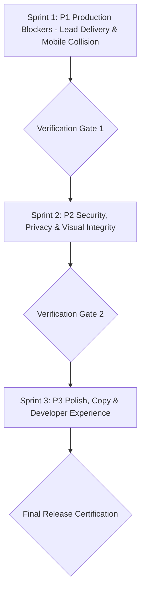

# KRYNEX LABS — VERIFIED REMEDIATION PLAN & IMPLEMENTATION ROADMAP
**Version:** 2.0.0 (Execution Blueprint)  
**Date:** October 24, 2026  
**Auditor Roles:** Principal Software Architect, Application Security Engineer, Senior Next.js Engineer, QA Automation Engineer, Production Release Manager  
**Target Application:** Krynex Labs Production Web Platform (`https://www.krynexlabs.in`)  
**Status:** AWAITING EXPLICIT HUMAN APPROVAL TO EXECUTE  

---

## 1. Remediation Ordering & Release Gate Architecture

Remediation is sequenced strictly into four prioritized sprints to ensure maximum stability and zero production regressions.



---

## 2. Sprint 1 — Production Blockers (P1 Findings)
*Release Blocker Status: MANDATORY BEFORE NEXT RELEASE*

### Task 1.1: Remediate Inbound Lead Dropping in `/api/contact` (`SEC-001`)
- **Order:** 1
- **Target File:** [src/app/api/contact/route.ts](file:///E:/.COM/KL_WEBSITE/src/app/api/contact/route.ts)
- **Problem:** Email delivery errors (SMTP exception or non-200 Resend response) are swallowed; API responds with 200 OK, giving false delivery confirmation while dropping the lead.
- **Required Code Changes:**
  1. Capture Resend API response:
     ```ts
     const resendResponse = await fetch("https://api.resend.com/emails", { ... });
     const resendOk = resendResponse.ok;
     let providerError: string | null = null;
     if (!resendOk) {
       const errJson = await resendResponse.json().catch(() => ({}));
       providerError = errJson?.message || `Resend HTTP ${resendResponse.status}`;
     }
     ```
  2. Maintain a delivery tracking flag:
     `let isDelivered = false;`
     Update `isDelivered = true` if Resend returns 2xx or Nodemailer yields `info.messageId`.
  3. If all configured delivery channels fail (or if no credentials are configured):
     Return HTTP `502 Bad Gateway` or `503 Service Unavailable`:
     ```ts
     if (!isDelivered) {
       return NextResponse.json(
         {
           ok: false,
           success: false,
           referenceId,
           error: "Automated delivery gateway is temporarily unavailable. Your transmission was logged under Reference ID: " + referenceId + ". Please email support@krynexlabs.in directly.",
         },
         { status: 503 }
       );
     }
     ```
  4. In `ContactForm.tsx`, `Footer.tsx`, and `DemoModal.tsx`:
     Ensure that when `response.status === 503` or `!result.ok`, the UI displays a prominent fallback error banner with a pre-filled direct `mailto:support@krynexlabs.in?subject=[Krynex Inquiry] ${result.referenceId}` link.
- **Dependencies:** None.
- **Estimated Effort:** 2 hours.
- **Risk Assessment:** Low. Purely adds defensive error propagation without modifying data contracts.
- **Required Configuration:** Ensure `RESEND_API_KEY` and verified `CONTACT_FROM_EMAIL` exist in Vercel production environment variables.
- **Regression Tests:**
  - Mock Resend 403 Forbidden; verify endpoint returns 503 and UI displays fallback email banner.
  - Mock Resend 200 OK; verify endpoint returns 200 and UI displays confetti and success docket.
- **Rollback Considerations:** Revert `route.ts` commit.
- **Approval Requirements:** **EXPLICIT HUMAN APPROVAL REQUIRED**.

---

### Task 1.2: Remediate Mobile Stacking Collision Between Sticky CTA and Cookie Banner (`UI-001`)
- **Order:** 2
- **Target Files:**
  - [src/components/StickyMobileCTA.tsx](file:///E:/.COM/KL_WEBSITE/src/components/StickyMobileCTA.tsx)
  - [src/components/CookieBanner.tsx](file:///E:/.COM/KL_WEBSITE/src/components/CookieBanner.tsx)
- **Problem:** Both elements occupy `fixed bottom-4` (`z-50`) on screens <768px, stacking directly over each other and obscuring interactive tap targets.
- **Required Code Changes:**
  1. In `CookieBanner.tsx`, dispatch a window custom event or read cookie consent presence:
     When the cookie banner mounts, set a class or state indicating banner visibility.
  2. In `StickyMobileCTA.tsx`:
     Check if cookie consent is already established in `localStorage`. If not established (meaning the cookie banner is active), adjust sticky CTA positioning to `bottom-28` or hide the sticky bar until cookie consent is dismissed.
     ```tsx
     const [hasCookieConsent, setHasCookieConsent] = useState(true);
     useEffect(() => {
       const consent = safeLocalStorage.getItem("krynex_cookie_consent");
       setHasCookieConsent(Boolean(consent));
     }, []);
     ```
     Apply `bottom-4` when consent is present; defer or offset when pending.
- **Dependencies:** None.
- **Estimated Effort:** 1.5 hours.
- **Risk Assessment:** Very low. Isolated to mobile responsive CSS positioning.
- **Required Configuration:** None.
- **Regression Tests:**
  - Open Chrome DevTools in iPhone 13 (390x844) mode with empty `localStorage`. Scroll down past 280px; verify zero physical overlap between CTA and Cookie Banner.
  - Click "Accept Telemetry"; verify Cookie Banner smoothly unmounts and Sticky CTA transitions to `bottom-4`.
- **Rollback Considerations:** Revert CSS classes.
- **Approval Requirements:** **EXPLICIT HUMAN APPROVAL REQUIRED**.

---

## 3. Sprint 2 — Stability, Security & Quality (P2 Findings)

### Task 2.1: Prepend Google Consent Mode v2 Default Denied State (`SEC-003`)
- **Order:** 3
- **Target Files:**
  - [src/app/layout.tsx](file:///E:/.COM/KL_WEBSITE/src/app/layout.tsx)
  - [src/components/Analytics.tsx](file:///E:/.COM/KL_WEBSITE/src/components/Analytics.tsx)
- **Required Code Changes:**
  1. In `layout.tsx`, add an inline `<Script id="google-consent" strategy="beforeInteractive">` declaring:
     ```js
     window.dataLayer = window.dataLayer || [];
     function gtag(){dataLayer.push(arguments);}
     gtag('consent', 'default', {
       'analytics_storage': 'denied',
       'ad_storage': 'denied',
       'ad_user_data': 'denied',
       'ad_personalization': 'denied'
     });
     ```
  2. In `Analytics.tsx`, guard `win.gtag("config", ...)` route tracking so it only dispatches when `safeLocalStorage.getItem("krynex_cookie_consent") === "all"`.
- **Estimated Effort:** 1 hour.
- **Risk Assessment:** Very low. Standard Google Consent Mode v2 protocol.
- **Approval Requirements:** Human approval for analytics configuration.

---

### Task 2.2: Calibrate BentoGrid Card 1 SVG Bezier ViewBox (`UI-002`)
- **Order:** 4
- **Target File:** [src/components/BentoGrid.tsx](file:///E:/.COM/KL_WEBSITE/src/components/BentoGrid.tsx)
- **Required Code Changes:**
  Add a calibrated `viewBox="0 0 800 240"` and `preserveAspectRatio="xMidYMid meet"` to `<svg>`, replacing absolute pixel unscaled paths with viewBox-relative curves that stay synchronized with button borders across all viewport widths (1024px to 4K).
- **Estimated Effort:** 2 hours.
- **Risk Assessment:** Low (visual only).

---

### Task 2.3: Convert Dynamic Monogram Icons to Static Assets (`PERF-001`)
- **Order:** 5
- **Target Files:**
  - [src/app/icon.tsx](file:///E:/.COM/KL_WEBSITE/src/app/icon.tsx)
  - [src/app/apple-icon.tsx](file:///E:/.COM/KL_WEBSITE/src/app/apple-icon.tsx)
- **Required Code Changes:**
  Generate pre-rendered static `icon.png` (32x32) and `apple-icon.png` (180x180) in `src/app/` or `public/`, eliminating dynamic Edge compute overhead on every favicon request.
- **Estimated Effort:** 1.5 hours.
- **Risk Assessment:** Very low.

---

### Task 2.4: Deduplicate Inbound Inquiry State Hook (`ARCH-001`)
- **Order:** 6
- **Target Files:**
  - `src/lib/useInquiryForm.ts` (New Hook)
  - [src/components/ContactForm.tsx](file:///E:/.COM/KL_WEBSITE/src/components/ContactForm.tsx)
  - [src/components/Footer.tsx](file:///E:/.COM/KL_WEBSITE/src/components/Footer.tsx)
  - [src/components/DemoModal.tsx](file:///E:/.COM/KL_WEBSITE/src/components/DemoModal.tsx)
- **Required Code Changes:**
  Extract shared state, honeypot handling, validation regexes, and submit orchestration into `useInquiryForm`.
- **Estimated Effort:** 3 hours.
- **Risk Assessment:** Low. Verified by existing 18 regression suites.

---

### Task 2.5: Add `vercel.json` Region Pinning (`DEPLOY-001`)
- **Order:** 7
- **Target File:** `vercel.json` (New File at Project Root)
- **Required Code Changes:**
  Create `vercel.json` pinning serverless functions to Mumbai (`bom1`) with a 15-second `maxDuration`.
- **Estimated Effort:** 0.5 hours.
- **Risk Assessment:** Very low.

---

## 4. Sprint 3 — Polish, Copy & Developer Experience (P3 Findings)

### Task 3.1: Add `"type": "module"` to `package.json` (`PERF-003`)
- **Order:** 8
- **Target File:** [package.json](file:///E:/.COM/KL_WEBSITE/package.json)
- **Required Code Changes:** Add `"type": "module"`. Eliminates Node typeless module reparsing warning.
- **Estimated Effort:** 0.5 hours.

### Task 3.2: Elevate Muted Telemetry Contrast to `text-zinc-400` (`A11Y-002`)
- **Order:** 9
- **Target Files:** [src/components/Footer.tsx](file:///E:/.COM/KL_WEBSITE/src/components/Footer.tsx), [DraftingDemo.tsx](file:///E:/.COM/KL_WEBSITE/src/components/DraftingDemo.tsx)
- **Required Code Changes:** Replace `text-zinc-500` with `text-zinc-400` on small telemetry labels to achieve 8.08:1 contrast (exceeding WCAG AAA).
- **Estimated Effort:** 1 hour.

### Task 3.3: Update Resend Verbatim Copy in Footer and Modal (`UI-003`)
- **Order:** 10
- **Target Files:**
  - [src/components/Footer.tsx](file:///E:/.COM/KL_WEBSITE/src/components/Footer.tsx)
  - [src/components/DemoModal.tsx](file:///E:/.COM/KL_WEBSITE/src/components/DemoModal.tsx)
  - [src/app/contact/page.tsx](file:///E:/.COM/KL_WEBSITE/src/app/contact/page.tsx)
- **Required Code Changes:** Replace "Get personal, reliable support from people who know your setup and care about your success" with authentic enterprise B2B product copy.
- **Estimated Effort:** 0.5 hours.

### Task 3.4: Remove Unused `WhatsAppButton.tsx` (`FUNC-001`)
- **Order:** 11
- **Target File:** [src/components/WhatsAppButton.tsx](file:///E:/.COM/KL_WEBSITE/src/components/WhatsAppButton.tsx)
- **Required Code Changes:** Delete unused stub file.
- **Estimated Effort:** 0.25 hours.

---

## 5. Comprehensive Task Master Matrix

| Task ID | Phase | Priority | Title | Target File | Effort | Risk | Approval |
| :--- | :--- | :--- | :--- | :--- | :--- | :--- | :--- |
| **ACT-01** | Sprint 1 | **P1** | Handle Provider Delivery Failures in Contact API | `src/app/api/contact/route.ts` | 2.0h | Low | **Required** |
| **ACT-02** | Sprint 1 | **P1** | Offset Mobile Sticky CTA to Prevent Banner Overlap | `StickyMobileCTA.tsx`, `CookieBanner.tsx` | 1.5h | Low | **Required** |
| **ACT-03** | Sprint 2 | **P2** | Add Google Consent Mode v2 Default Denied State | `layout.tsx`, `Analytics.tsx` | 1.0h | Low | **Required** |
| **ACT-04** | Sprint 2 | **P2** | Calibrate BentoGrid SVG Bezier Coordinate ViewBox | `BentoGrid.tsx` | 2.0h | Low | No |
| **ACT-05** | Sprint 2 | **P2** | Pre-render Static Favicon & Apple Icon PNGs | `icon.tsx`, `apple-icon.tsx` | 1.5h | Low | No |
| **ACT-06** | Sprint 2 | **P2** | Deduplicate Inbound Inquiry State Hook | `useInquiryForm.ts`, Form components | 3.0h | Low | No |
| **ACT-07** | Sprint 2 | **P2** | Create `vercel.json` with Mumbai Region Pinning | `vercel.json` | 0.5h | Low | **Required** |
| **ACT-08** | Sprint 3 | **P3** | Add `"type": "module"` to `package.json` | `package.json` | 0.5h | Low | No |
| **ACT-09** | Sprint 3 | **P3** | Elevate Secondary Telemetry Contrast to zinc-400 | `Footer.tsx`, `DraftingDemo.tsx` | 1.0h | Low | No |
| **ACT-10** | Sprint 3 | **P3** | Replace Copied Resend Support Copy | `Footer.tsx`, `DemoModal.tsx` | 0.5h | Low | **Required** |
| **ACT-11** | Sprint 3 | **P3** | Remove Dead `WhatsAppButton.tsx` Stub | `WhatsAppButton.tsx` | 0.25h| Zero | No |

**Total Estimated Implementation Effort:** ~14.75 engineering hours.
