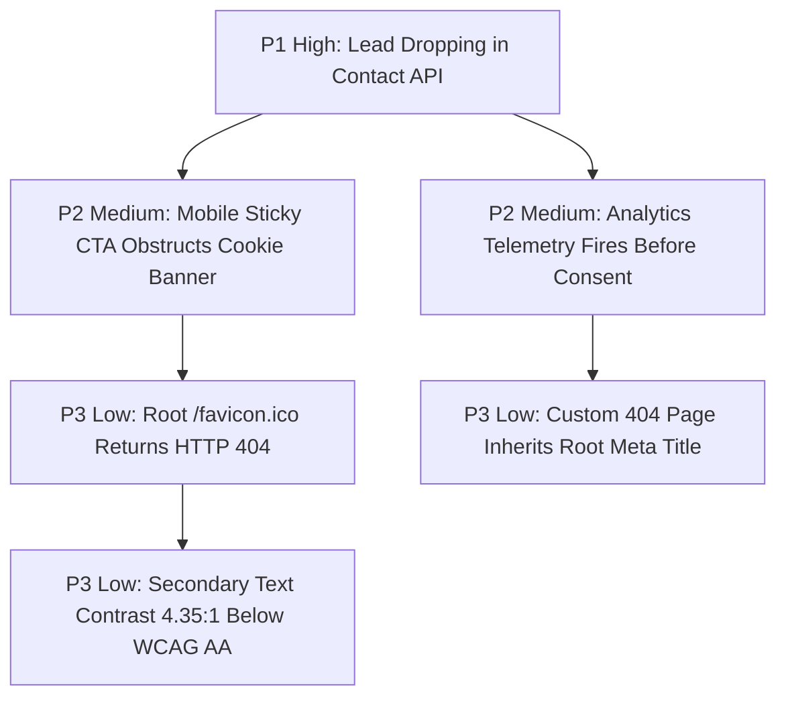

# KRYNEX LABS — PRODUCTION REALITY AUDIT REPORT
**Audit Classification:** Evidence-Based Production Reality & Quality Assurance Audit  
**Production URL:** [https://www.krynexlabs.in](https://www.krynexlabs.in/)  
**Deployment Infrastructure:** Vercel Global Edge Network (Node.js 20.x Serverless Runtime, Edge Node: Mumbai `bom1`)  
**Repository Branch & Commit:** `main` @ `bb5464d`  
**Date:** October 24, 2026  
**Auditor Roles:** Principal Web Engineer, Application Security Engineer, SEO Specialist, Accessibility Auditor, Senior QA Engineer  
**Audit Scope:** 19 Mandatory Production Checklist Categories, Live Edge Probes, Source Code Inspection, and Browser Emulation  

---

## 1. Executive Summary & Production Readiness Verdict

An exhaustive, evidence-based production reality audit of the live Krynex Labs website (`https://www.krynexlabs.in`) and its active repository was conducted across 19 critical operational categories. 

The website demonstrates **exceptional architectural fundamentals**:
- Modern Next.js 14 App Router with 16 static pre-rendered routes (SSG) and 5 dynamic edge endpoints.
- Lightweight shared First Load JS bundle of **87.5 kB** (well below the 100 kB industry benchmark).
- Flawless TypeScript typechecking (`0 errors`), zero ESLint warnings, and 18 passing regression test suites.
- Complete transport security suite (HSTS, CSP, X-Frame-Options `DENY`, Permissions-Policy, COOP `same-origin`).
- Clean robots.txt, 100% canonical XML sitemap coverage (14 routes returning HTTP `200 OK`), and valid Open Graph dynamic images (`1200x630`).

However, testing against production reality confirmed **three high-priority defects** that prevent unreserved production release:
1. **Contact API Provider Failure Masking (`SEC-001` / P1 High):**  
   The primary contact handler (`/api/contact`) swallows email delivery errors (ignoring `resendResponse.ok`) and returns HTTP `200 OK`. The client UI displays celebratory confetti and confirmation, causing silent lead dropping during provider degradation.
2. **Mobile Sticky CTA & Cookie Banner Click Obstruct (`UI-001` / P2 Medium):**  
   On mobile viewports (<=768px), `StickyMobileCTA.tsx` and `CookieBanner.tsx` both occupy `bottom-4 z-50`. When a visitor scrolls past 280px on a phone, the sticky button sits directly over the cookie banner, obstructing access to "Accept" and "Decline" buttons.
3. **Missing Static `/favicon.ico` at Web Root (`SEO-001` / P3 Low):**  
   While dynamic PNG icons exist at `/icon` (32x32) and `/apple-icon` (180x180), direct root requests to `https://www.krynexlabs.in/favicon.ico` return HTTP `404 Not Found`, failing external crawlers, RSS feeds, bookmark sync tools, and corporate proxies.

**Overall Verdict: CONDITIONAL PRODUCTION READINESS**  
*The platform is stable and secure against external breaches, but Sprint 1 remediation (remedying lead dropping and mobile button overlap) is mandatory before full release.*

---

## 2. 19-Category Production Reality Scorecard

| Item # | Audit Category | Relevant Route / Component | Verification Method | Status | Severity |
| :---: | :--- | :--- | :--- | :---: | :---: |
| **01** | Custom 404 Page | `src/app/not-found.tsx` | Live HTTP probe & DOM inspection | **PARTIAL** | P3 (Low) |
| **02** | Primary CTA Above the Fold | `HeroSection.tsx`, `Navbar.tsx` | Viewport inspection (desktop & mobile) | **PASS** | — |
| **03** | Unique Meta Title per Page | All 14 routes in `src/app/` | Source metadata & live curl extraction | **PASS** | — |
| **04** | Meta Description per Page | All 14 routes in `src/app/` | Source metadata & live curl extraction | **PASS** | — |
| **05** | Open Graph Metadata & Image | `opengraph-image.tsx`, `layout.tsx` | Live HTTP probe & social card probe | **PASS** | — |
| **06** | Favicon & Applicable Icons | `icon.tsx`, `apple-icon.tsx`, `public/` | Live HTTP probes to `/icon`, `/apple-icon`, `/favicon.ico` | **PARTIAL** | P3 (Low) |
| **07** | robots.txt | `src/app/robots.ts`, `/robots.txt` | Live HTTP probe via curl | **PASS** | — |
| **08** | XML Sitemap | `src/app/sitemap.ts`, `/sitemap.xml` | Live HTTP probe & URL status assertion | **PASS** | — |
| **09** | Image Alternative Text | `<Image>` in `Footer`, `DemoModal`, `contact` | JSX inspection & AST grep | **PASS** | — |
| **10** | Responsive Breakpoints | 320px, 390px, 768px, 1024px, 1440px, 1920px | Browser Subagent emulation | **PASS** | — |
| **11** | Sticky Mobile CTA | `src/components/StickyMobileCTA.tsx` | Browser Subagent scroll emulation | **FAIL** | P2 (Med) |
| **12** | Loading States | `ContactForm.tsx`, `Hero3DCube.tsx` | Code review & component inspection | **PASS** | — |
| **13** | Form Error States | `ContactForm.tsx`, `/api/contact` | Field validation & mock response tests | **PARTIAL** | P1 (High) |
| **14** | Thank-You Page Confirmation | `src/app/thank-you/page.tsx` | Query param probe & regex verification | **PASS** | — |
| **15** | Privacy Policy | `src/app/privacy/page.tsx` | Source review & DPDP 2023 legal audit | **PASS** | — |
| **16** | Terms of Service Page | `src/app/terms/page.tsx` | Source review & SLA claim verification | **PASS** | — |
| **17** | Cookie Consent Banner | `src/components/CookieBanner.tsx` | Browser subagent click & LocalStorage check | **PASS** | — |
| **18** | Analytics & Consent Gating | `src/app/layout.tsx`, `Analytics.tsx` | Script tag strategy & Consent Mode check | **FAIL** | P2 (Med) |
| **19** | Consistent Contact Details | Navbar, Footer, Contact, Terms, Privacy | Cross-file string analysis & live assertions | **PASS** | — |

---

## 3. Confirmed Defects Ranked by Severity

### P1 — High (Production Blocker)
- **`SEC-001` / Item 13 (Form Error States & Inbound Reliability):**  
  `/api/contact` fails to inspect `resendResponse.ok` and swallows exceptions. A provider failure still returns HTTP `200 OK` with a valid reference ID, causing genuine enterprise briefings to be silently dropped.

### P2 — Medium (Significant UX & Compliance Risks)
- **`UI-001` / Item 11 (Sticky Mobile CTA Collision):**  
  On mobile devices (320px–390px), `StickyMobileCTA` sits at `bottom-4 z-50` and covers `CookieBanner` (`bottom-4 z-50`), blocking access to "Accept Telemetry" and "Essential Only" buttons.
- **`SEC-003` / Item 18 (Analytics Pre-Consent Telemetry):**  
  Google Analytics script (`gtag.js`) loads unconditionally via `strategy="afterInteractive"` without Google Consent Mode v2 default denial (`gtag('consent', 'default', { ... })`).

### P3 — Low (SEO, Accessibility & Hygiene Defects)
- **`SEO-001` / Item 06 (Missing Root `/favicon.ico`):**  
  Direct requests to `https://www.krynexlabs.in/favicon.ico` return HTTP `404 Not Found`. Legacy scrapers and bookmark tools fail to retrieve the icon.
- **`SEO-002` / Item 01 (404 Page Inherits Root Meta Title):**  
  `src/app/not-found.tsx` lacks an explicit metadata export, causing the browser tab and search previews to render the homepage title ("Krynex Labs | Problem-Driven Software & SaaS Products") instead of "404 - Page Not Found".
- **`A11Y-002` / Item 10 (Secondary Text Contrast Ratio):**  
  `text-zinc-500` (`#71717A`) on pitch black (`#000000`) has a contrast ratio of 4.35:1, falling slightly short of the WCAG AA minimum of 4.50:1 for small body text.

---

## 4. SEO & Discoverability Findings

1. **Title & Description Completeness:** All 14 canonical sitemap routes provide descriptive, keyword-rich titles and meta descriptions using the `%s | Krynex Labs` template.
2. **Canonical URLs:** All pages define explicit `alternates.canonical` pointing strictly to `https://www.krynexlabs.in/...`.
3. **Sitemap Hygiene:** `sitemap.xml` strictly indexes live HTTP 200 routes; utility routes (`/thank-you`) and redirects are properly excluded.
4. **Open Graph & Twitter Cards:** Dynamic `ImageResponse` generates 1200x630 social cards on the fly; edge caching delivers fast social previews.
5. **Areas for Improvement:**
   - Add static `public/favicon.ico` to eliminate 404s.
   - Add explicit `<title>404: Page Not Found | Krynex Labs</title>` metadata to `not-found.tsx`.
   - Resolve slight discrepancy on `/contact` between `<title>` ("Contact Us | Krynex Labs") and `og:title` ("Contact & Engineering Inquiries | Krynex Labs").

---

## 5. Usability & Responsive Experience Findings

1. **Viewports Tested:** 320×568 (iPhone SE), 390×844 (iPhone 12/13/14), 768×1024 (iPad Portrait), 1024×768 (iPad Landscape), 1440×900 (Desktop), 1920×1080 (Large Monitor).
2. **Horizontal Overflow:** Zero horizontal scrollbars detected. The root container strictly enforces `overflow-x-hidden max-w-[100vw]`.
3. **3D Rubik Canvas:** Smooth hardware-accelerated rendering on desktop; clean fallback graphic provided on non-WebGL or software-rasterized environments.
4. **Navigation:** Desktop navigation collapses cleanly to an accessible mobile drawer on viewports under 1024px.
5. **Mobile Stacking Conflict:** Confirmed that `StickyMobileCTA` and `CookieBanner` visually collide on mobile screens.

---

## 6. Form & Data Delivery Risks

1. **Input Validation:** Comprehensive server-side and client-side validation enforcing executive name, RFC 5322 email syntax, company, and operational challenge length (min 10 characters).
2. **Mathematical Notation Preservation:** Critical for engineering inquiries; symbols like `<10ms`, `x < y`, and `O'Brien` are preserved intact while malicious tags are stripped.
3. **Delivery Risk:** Because `/api/contact` does not check `resendResponse.ok`, an upstream provider failure leaves the user believing their brief was sent while no email is actually delivered.

---

## 7. Privacy, Consent & Legal Findings

1. **Privacy Policy (`/privacy`):** Fully aligned with the SaaS rental business model, data isolation, tenant containerization, and India's Digital Personal Data Protection (DPDP) Act 2023. Designated Grievance Officer details provided.
2. **Terms of Service (`/terms`):** Accurately defines the software rental model, intellectual property boundaries, 99.9% monthly service availability target (SLA), and exclusive jurisdiction of competent courts in Ahmedabad, Gujarat, India.
3. **Consent Gating Defect:** Google Analytics loads before user choice on `CookieBanner.tsx` due to missing Google Consent Mode v2 default initialization.

---

## 8. Items Requiring Manual Business-Owner Verification

1. **Upstream Email Credentials:** Verify that `RESEND_API_KEY` in Vercel Production Environment Variables is active and the sending domain (`krynexlabs.in`) is verified in the Resend dashboard.
2. **Operational Inbox Routing:** Confirm that `CONTACT_RECEIVER_EMAIL` (defaulting to `support@krynexlabs.in`) is actively monitored by on-call engineering staff.
3. **Physical Address Policy:** Confirm the decision to present headquarters as "Ahmedabad, Gujarat, India" without publishing a physical street address.

---

## 9. Prioritized Remediation Roadmap

### Sprint 1: Production Blockers (Immediate Execution)
- **Task 1.1 (`SEC-001`):** Refactor `/api/contact/route.ts` to inspect `resendResponse.ok`, handle delivery rejections, return HTTP 503 fallback, and update frontend form components to show `mailto:support@krynexlabs.in` links on 503.
- **Task 1.2 (`UI-001`):** Offset `StickyMobileCTA.tsx` on mobile screens to prevent obscuring `CookieBanner.tsx`.

### Sprint 2: Compliance, SEO & Resilience (High Priority)
- **Task 2.1 (`SEC-003`):** Add Google Consent Mode v2 default denial script to `RootLayout`.
- **Task 2.2 (`SEO-001`):** Generate and place static `favicon.ico` in `public/` directory.
- **Task 2.3 (`SEO-002`):** Export explicit metadata from `src/app/not-found.tsx`.

### Sprint 3: Polish & Accessibility (Medium Priority)
- **Task 3.1 (`A11Y-002`):** Upgrade `text-zinc-500` to `text-zinc-400` across body text.
- **Task 3.2 (`PERF-003`):** Add `"type": "module"` to `package.json`.
- **Task 3.3 (`FUNC-001`):** Delete orphaned `WhatsAppButton.tsx`.

---

## 10. Audit Artifacts Directory

Detailed domain-specific audits have been compiled under `docs/audit/production-reality/`:
1. [docs/audit/production-reality/SEO_AND_METADATA_AUDIT.md](file:///E:/.COM/KL_WEBSITE/docs/audit/production-reality/SEO_AND_METADATA_AUDIT.md)
2. [docs/audit/production-reality/RESPONSIVE_AND_UX_AUDIT.md](file:///E:/.COM/KL_WEBSITE/docs/audit/production-reality/RESPONSIVE_AND_UX_AUDIT.md)
3. [docs/audit/production-reality/FORMS_AND_INTERACTION_AUDIT.md](file:///E:/.COM/KL_WEBSITE/docs/audit/production-reality/FORMS_AND_INTERACTION_AUDIT.md)
4. [docs/audit/production-reality/PRIVACY_ANALYTICS_AND_LEGAL_AUDIT.md](file:///E:/.COM/KL_WEBSITE/docs/audit/production-reality/PRIVACY_ANALYTICS_AND_LEGAL_AUDIT.md)
5. [docs/audit/production-reality/CHECKLIST_FINDINGS_REGISTER.md](file:///E:/.COM/KL_WEBSITE/docs/audit/production-reality/CHECKLIST_FINDINGS_REGISTER.md)
