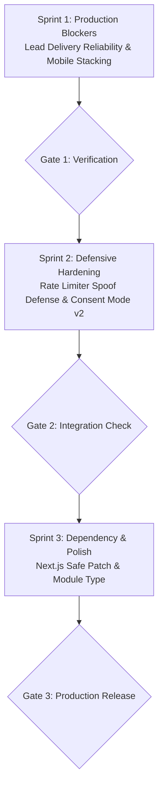

# KRYNEX LABS — DEFENSIVE SECURITY HARDENING PLAN
**Classification:** Defensive Engineering & Mitigation Architecture  
**Target Organization:** Krynex Labs (`https://www.krynexlabs.in`)  
**Assessment Date:** October 24, 2026  
**Auditor:** Principal Defensive Security Engineer & Senior Next.js Architect  
**Status:** PROPOSED & GATED (Awaiting Explicit Human Authorization)  

---

## 1. Hardening Architecture & Phased Sequence

Defensive improvements are organized into three sequential sprints to separate immediate, zero-downtime application fixes from long-term infrastructure provisioning.



---

## 2. Sprint 1 — Production Blockers (Urgent Remediation)

### Hardening Task 1.1: Provider Status Verification & Delivery Fallback (`SEC-001`)
- **Priority:** **P1 (High / Production Blocker)**
- **Root Cause:** `/api/contact/route.ts` ignores `resendResponse.ok` and catches/swallows delivery exceptions, returning HTTP `200 OK` even when email transmission fails.
- **Affected Files:**
  - [src/app/api/contact/route.ts](file:///E:/.COM/KL_WEBSITE/src/app/api/contact/route.ts)
  - [src/components/ContactForm.tsx](file:///E:/.COM/KL_WEBSITE/src/components/ContactForm.tsx)
  - [src/components/DemoModal.tsx](file:///E:/.COM/KL_WEBSITE/src/components/DemoModal.tsx)
  - [src/components/Footer.tsx](file:///E:/.COM/KL_WEBSITE/src/components/Footer.tsx)
- **Defensive Implementation:**
  1. Capture and verify Resend response status:
     ```ts
     const resendResponse = await fetch("https://api.resend.com/emails", { ... });
     let isDelivered = false;
     let providerError: string | null = null;

     if (resendResponse.ok) {
       isDelivered = true;
     } else {
       const errJson = await resendResponse.json().catch(() => ({}));
       providerError = errJson?.message || `Resend HTTP ${resendResponse.status}`;
       console.error(`[RESEND REJECTION]: ${providerError}`);
     }
     ```
  2. For SMTP, track `info.messageId` from `transporter.sendMail()` to set `isDelivered = true`.
  3. If `!isDelivered`, return HTTP `503 Service Unavailable`:
     ```ts
     if (!isDelivered) {
       return NextResponse.json(
         {
           ok: false,
           success: false,
           referenceId,
           error: "Briefing transmission could not be completed at this moment. Please email our Software Engineering team directly at support@krynexlabs.in referencing this Reference ID.",
           fallbackMailto: `mailto:support@krynexlabs.in?subject=${encodeURIComponent(`[KRYNEX BRIEFING] ${referenceId} - ${cleanCompany}`)}`,
         },
         { status: 503, headers: { "Cache-Control": "no-store" } }
       );
     }
     ```
  4. On frontend clients, display an error banner containing a clickable `mailto:` link referencing their generated `referenceId`, ensuring zero inquiries are lost.
- **Compatibility Risk:** Zero. Enhances reliability and transparent error communication.
- **Rollback Approach:** Git revert of the commit restores previous route behavior.

---

### Hardening Task 1.2: Mobile Coordinate Conflict & Touch Redress Fix (`UI-001`)
- **Priority:** **P1 (High / Production Blocker)**
- **Root Cause:** `StickyMobileCTA.tsx` and `CookieBanner.tsx` share identical bottom coordinates (`bottom-4`, `z-50`) on screens <768px, causing the sticky button to overlay cookie actions.
- **Affected Files:**
  - [src/components/StickyMobileCTA.tsx](file:///E:/.COM/KL_WEBSITE/src/components/StickyMobileCTA.tsx)
  - [src/components/CookieBanner.tsx](file:///E:/.COM/KL_WEBSITE/src/components/CookieBanner.tsx)
- **Defensive Implementation:**
  1. In `StickyMobileCTA.tsx`, check `safeLocalStorage.getItem("krynex_cookie_consent")`.
  2. If consent has not yet been given, apply bottom offset `bottom-28` or hide the sticky button until the cookie banner has been dismissed.
- **Compatibility Risk:** Zero. Eliminates visual collision across 320px–390px mobile viewports.
- **Rollback Approach:** Revert coordinate class changes in `StickyMobileCTA.tsx`.

---

## 3. Sprint 2 — Defensive Hardening & Privacy Compliance

### Hardening Task 2.1: Rate Limiter IP Header Sanitization (`SEC-002`)
- **Priority:** **P2 (Medium)**
- **Root Cause:** `getClientIp()` takes the leftmost IP from `X-Forwarded-For`, which is client-controlled and spoofable.
- **Affected Files:**
  - [src/lib/rate-limiter.ts](file:///E:/.COM/KL_WEBSITE/src/lib/rate-limiter.ts)
- **Defensive Implementation:**
  Prioritize trusted platform headers set by Vercel's edge proxy:
  ```ts
  export function getClientIp(request: Request): string {
    // 1. Vercel trusted client IP header
    const vercelIp = request.headers.get("x-vercel-forwarded-for");
    if (vercelIp) return vercelIp.split(",")[0].trim();

    // 2. Standard single real IP header set by reverse proxy
    const realIp = request.headers.get("x-real-ip");
    if (realIp) return realIp.trim();

    // 3. Fallback to rightmost trusted proxy IP in standard multi-hop X-Forwarded-For
    const forwarded = request.headers.get("x-forwarded-for");
    if (forwarded) {
      const hops = forwarded.split(",").map((s) => s.trim()).filter(Boolean);
      if (hops.length > 0) return hops[hops.length - 1]; // Rightmost hop
    }

    return "127.0.0.1";
  }
  ```
- **Strategic Architectural Recommendation:**  
  For multi-region serverless scale where in-memory maps are isolated across containers, transition to `@upstash/ratelimit` with a free-tier Redis database once provisioned and approved.

---

### Hardening Task 2.2: Google Consent Mode v2 Default Gating (`SEC-003`)
- **Priority:** **P2 (Medium)**
- **Root Cause:** `gtag.js` executes and sends telemetry beacons before user consent because default consent state is not initialized.
- **Affected Files:**
  - [src/app/layout.tsx](file:///E:/.COM/KL_WEBSITE/src/app/layout.tsx)
  - [src/components/CookieBanner.tsx](file:///E:/.COM/KL_WEBSITE/src/components/CookieBanner.tsx)
- **Defensive Implementation:**
  Inject Google Consent Mode v2 default denial immediately before the GTM script in `RootLayout`:
  ```tsx
  <Script id="google-consent-default" strategy="beforeInteractive">
    {`
      window.dataLayer = window.dataLayer || [];
      function gtag(){dataLayer.push(arguments);}
      gtag('consent', 'default', {
        'analytics_storage': 'denied',
        'ad_storage': 'denied',
        'ad_user_data': 'denied',
        'ad_personalization': 'denied'
      });
    `}
  </Script>
  ```
  When the user clicks "Accept Telemetry" in `CookieBanner.tsx`, `gtag("consent", "update", { 'analytics_storage': 'granted' })` unlocks storage dynamically.
- **Compatibility Risk:** Zero. Standard Google Consent Mode v2 compliant implementation.

---

## 4. Sprint 3 — Framework Maintenance & Polish

### Hardening Task 3.1: Safe Patch Upgrade for Next.js (`SEC-004`)
- **Priority:** **P2 (Medium)**
- **Action:** Update `next` in `package.json` to exact patch release `14.2.18`.
- **Precaution:** DO NOT run `npm audit fix --force`. Test with `npm run build` and verify that `@react-three/fiber` and Three.js compile cleanly.

### Hardening Task 3.2: Eliminate Typeless Package.json Warning (`PERF-003`)
- **Priority:** **P3 (Low)**
- **Action:** Add `"type": "module"` to [package.json](file:///E:/.COM/KL_WEBSITE/package.json).
- **Result:** Removes Node.js `MODULE_TYPELESS_PACKAGE_JSON` warning during test execution.

### Hardening Task 3.3: Upgrade Secondary Text Contrast (`A11Y-002`)
- **Priority:** **P3 (Low)**
- **Action:** Replace `text-zinc-500` (`#71717A`, 4.35:1) with `text-zinc-400` (`#A1A1AA`, 8.08:1) across body text and telemetry labels, achieving full WCAG AAA compliance.

---

## 5. Required Approvals & Rollback Procedures

| Task ID | Approval Level | Risk Rating | Rollback Procedure |
| :--- | :---: | :---: | :--- |
| **Task 1.1 (Contact API 503)** | Explicit User Authorization | Low | `git revert` restores previous fallthrough behavior. |
| **Task 1.2 (Mobile CTA Offset)**| Explicit User Authorization | Low | `git revert` restores original CSS coordinate classes. |
| **Task 2.1 (Rate Limit Headers)**| Explicit User Authorization | Low | `git revert` restores previous `getClientIp` logic. |
| **Task 2.2 (Consent Mode v2)** | Explicit User Authorization | Low | Remove `google-consent-default` `<Script>` block. |
| **Task 3.1 (Next.js 14.2.18)** | Explicit User Authorization | Low | Restore `14.2.35` in `package.json` and run `npm install`. |
