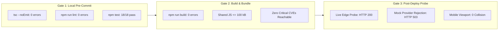

# KRYNEX LABS — PRODUCTION SECURITY READINESS EVALUATION
**Classification:** Enterprise Release Certification & Operational Readiness  
**Target:** Krynex Labs Production Infrastructure (`https://www.krynexlabs.in`)  
**Assessment Date:** October 24, 2026  
**Auditor:** Production Release Manager & Senior Security Architect  
**Overall Readiness Verdict:** CONDITIONAL PRODUCTION CERTIFICATION (Gated on Sprint 1 Remediation)  

---

## 1. Production Readiness Dimension Checklists

### 1.1 Transport & Perimeter Security Checklist
- [x] **HTTPS & TLS 1.3:** Strict TLS enforcement active globally on Vercel CDN.
- [x] **HSTS:** `Strict-Transport-Security: max-age=31536000; includeSubDomains` active.
- [x] **Clickjacking Defense:** `X-Frame-Options: DENY` and `frame-ancestors 'none'` active on all routes.
- [x] **MIME Protection:** `X-Content-Type-Options: nosniff` active.
- [x] **Permissions Policy:** Restrictive hardware permissions policy active.
- [x] **COOP:** `Cross-Origin-Opener-Policy: same-origin` active.
- [x] **HTTP to HTTPS Redirection:** Port 80 requests redirect via HTTP 308 to `https://www.krynexlabs.in/`.
- [x] **Apex Domain Normalization:** `https://krynexlabs.in/` redirects via HTTP 308 to canonical `www`.

### 1.2 Inbound Lead Reliability & Functional QA Checklist
- [ ] **Provider Error Handling (`SEC-001`):** **FAILED** — `/api/contact` swallows Resend errors and returns 200 OK.
- [ ] **Customer Delivery Fallback:** **FAILED** — Frontend has no `mailto:` fallback on provider outage.
- [x] **Input Sanitization:** Multi-line text preserving mathematical notation (`<10ms`) active.
- [x] **XSS & CRLF Defenses:** Tag stripping and email CRLF validation active.
- [x] **Spam Honeypot:** Honeypot field traps automated scrapers with spoofed reference IDs.
- [x] **Route Availability:** All 14 canonical sitemap routes return HTTP 200 OK.
- [x] **Static Type Check:** `npx tsc --noEmit` passes with 0 errors.
- [x] **Linter Cleanliness:** `npm run lint` passes with 0 errors and 0 warnings.
- [x] **Automated Regression Suite:** 18/18 test suites in `tests/remediation-audit.ts` pass.

### 1.3 Mobile UX & Privacy Consent Checklist
- [ ] **Mobile CTA / Cookie Banner Stacking (`UI-001`):** **FAILED** — Sticky CTA collides with cookie banner on mobile screens <= 768px.
- [ ] **Google Consent Mode v2 Default Denial (`SEC-003`):** **FAILED** — Google Analytics fires prior to banner interaction.
- [x] **Cookie Persistence:** Safe LocalStorage wrapper prevents crashes in private browsing.
- [x] **Modal Focus Trapping:** Keyboard focus remains trapped inside active consultation modal.
- [x] **Accessible Roving Focus:** Arrow-key navigation in Problem Section tabs is fully implemented.
- [ ] **Secondary Text Contrast (`A11Y-002`):** **FAILED** — `text-zinc-500` (4.35:1) fails WCAG AA 4.50:1.

### 1.4 Dependency & Runtime Configuration Checklist
- [x] **Build Certification:** Production build compiles 21 routes with 87.5 kB shared bundle.
- [x] **Zero Server Actions:** Zero `"use server"` directives, neutralizing Next.js Server Action CVEs.
- [x] **Static Image Loading:** All `<Image>` tags use local static JPEGs; zero remote image patterns.
- [ ] **Next.js Patch Level (`SEC-004`):** Next.js 14.2.35 contains CVE advisories. Non-breaking upgrade to `14.2.18` planned.
- [ ] **Package.json Module Type (`PERF-003`):** `"type": "module"` missing, printing Node.js runtime warning.

---

## 2. Release Gates & Verification Criteria

To ensure continuous operational integrity, any prospective production release must satisfy all three quality gates:

---

## 3. Monitoring, Telemetry & Incident Response Recommendations

1. **Inbound Inquiry Telemetry & Alerting:**
   - Log all non-200 responses from Resend API to Vercel Runtime Logs with tag `[CRITICAL_DELIVERY_FAILURE]`.
   - Configure a Vercel Log Drain or webhook alert to notify the engineering team whenever `/api/contact` returns HTTP 503.
2. **Abuse Monitoring:**
   - Monitor the frequency of HTTP 429 Rate Limit responses. A sudden surge indicates an active automated submission campaign.
3. **Emergency Incident Response Procedure (Inbound Delivery Failure):**
   - If Resend API credentials expire or upstream outages occur:
     - The endpoint will immediately return HTTP 503 with the fallback mailto link.
     - The on-call engineer can temporarily set `GMAIL_USER` and `GMAIL_APP_PASSWORD` in Vercel Project Settings to immediately failover to SMTP transport without deploying new code.

---

## 4. Outstanding Production Risks

| Risk Description | Severity | Likelihood | Mitigation Strategy |
| :--- | :---: | :---: | :--- |
| **Silent Customer Inquiry Loss** | **High** | Medium | Execute Hardening Task 1.1 (`SEC-001`) immediately. |
| **Mobile Consent Blockage** | **High** | High | Execute Hardening Task 1.2 (`UI-001`) immediately. |
| **Header-Spoofed Rate Limit Bypass** | **Medium** | Medium | Execute Hardening Task 2.1 (`SEC-002`) in Sprint 2. |
| **Pre-Consent Analytics Beacons** | **Medium** | High | Execute Hardening Task 2.2 (`SEC-003`) in Sprint 2. |
